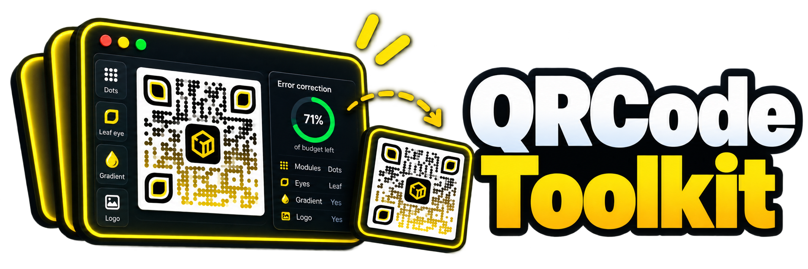

<p align="center">
    
</p>

# QrcodeToolkit

A QR code generator for Laravel that tells you what your styling costs — `dots` modules, a `leaf` eye, a gradient and a logo, and a report that says the code still has 74.6% of its error-correction budget left.

[](https://packagist.org/packages/gabrielesbaiz/qrcode-toolkit)
[](composer.json)
[](composer.json)
[](https://packagist.org/packages/gabrielesbaiz/qrcode-toolkit)
[](https://github.com/gabrielesbaiz/qrcode-toolkit/stargazers)
[](https://github.com/sponsors/gabrielesbaiz)

> [!IMPORTANT]
> A ⭐ costs you nothing and helps other developers find this package.
> [Sponsoring](https://github.com/sponsors/gabrielesbaiz) keeps it compatible
> with every new Laravel release.

## Contents

- [How it compares](#how-it-compares)
- [Requirements](#requirements)
- [Installation](#installation)
- [Quick start](#quick-start)
- [Styling](#styling)
  - [Module shapes](#module-shapes)
  - [Module scale](#module-scale)
  - [Eyes](#eyes)
  - [Colours](#colours)
  - [Gradients](#gradients)
  - [Transparency](#transparency)
  - [Logos](#logos)
  - [Captions](#captions)
  - [Frames](#frames)
- [Knowing whether it will scan](#knowing-whether-it-will-scan)
  - [The contrast guard](#the-contrast-guard)
  - [The scannability report](#the-scannability-report)
- [Output formats](#output-formats)
  - [SVG](#svg)
  - [PNG](#png)
  - [PDF and EPS](#pdf-and-eps)
  - [CMYK for print](#cmyk-for-print)
- [Payloads](#payloads)
  - [Links](#links)
  - [WiFi](#wifi)
  - [Contact cards](#contact-cards)
  - [Email, phone and SMS](#email-phone-and-sms)
  - [Locations](#locations)
  - [SEPA payments](#sepa-payments)
- [Getting the bytes out](#getting-the-bytes-out)
- [The Blade component](#the-blade-component)
- [Profiles](#profiles)
- [Caching](#caching)
- [Macros](#macros)
- [All methods](#all-methods)
- [Configuration](#configuration)
- [Recipes](#recipes)
- [Troubleshooting](#troubleshooting)
- [How it works](#how-it-works)
- [Security](#security)
- [Testing](#testing)
- [Credits](#credits)
- [Support this package](#support-this-package)
- [Disclaimer](#disclaimer)
- [Changelog](#changelog)
- [License](#license)

## How it compares

Checked on 2026-09-28 against each project's own source and documentation.
`?` means I could not verify it from a real page, not that the answer is no.

### Styling

| | **qrcode-toolkit** | bacon 3.1 | endroid 6.1 | chillerlan 6.0 | simple-qrcode 4.2 | Linkxtr 3.2 | quar 1.8 | 2amigos 4.x | lara-zeus/qr 3.0 |
|---|---|---|---|---|---|---|---|---|---|
| Module shapes | **6** | 3 | 0 | 2 | 3 | 3 | 5 | 3 | 3 |
| `diamond` / capsule runs | **yes** | no | no | no | no | no | no | no | no |
| Neighbour-aware rounding | **yes** | global roundness | — | — | — | — | — | — | — |
| Eye shapes | **6** | 5 | 0 | — | 2 | 3 | 4 | — | 2 |
| Per-eye colours | **ring and pupil, per eye** | per eye | no | per module type | no | yes | ? | ? | yes |
| Gradients | **linear at any angle, radial** | 5 fixed presets | no | SVG, hand-written | 5 presets | 5 presets | 5 presets | 5 presets | 5 presets |
| CMYK | **PDF + EPS** | **yes** | no | ? | no | **yes** | no | ? | no |
| Logo | yes | no | yes | space only | PNG only | yes | yes | yes | yes |
| Logo knock-out **before** shaping | **yes** | — | no | no | no | no | no | no | no |
| Caption | yes | no | yes | no | no | no | yes | yes | no |
| Frame | **yes** | no | no | no | no | no | no | no | no |

### Output

| | **qrcode-toolkit** | bacon 3.1 | endroid 6.1 | chillerlan 6.0 | simple-qrcode 4.2 | Linkxtr 3.2 | quar 1.8 | 2amigos 4.x | lara-zeus/qr 3.0 |
|---|---|---|---|---|---|---|---|---|---|
| SVG / PNG / PDF / EPS | **all four** | SVG, EPS, raster | all four | all four | SVG, PNG, EPS | + WebP | SVG, PNG, EPS | several | PNG |
| One geometry, every format | **yes** | no | no | no | no | no | no | no | no |
| PDF without a PDF dependency | **yes** | — | FPDF | FPDF | — | — | — | — | — |
| Byte-stable output | **guaranteed** | ? | ? | ? | ? | ? | ? | ? | ? |

### Knowing whether it will scan

| | **qrcode-toolkit** | bacon 3.1 | endroid 6.1 | chillerlan 6.0 | simple-qrcode 4.2 | Linkxtr 3.2 | quar 1.8 | 2amigos 4.x | lara-zeus/qr 3.0 |
|---|---|---|---|---|---|---|---|---|---|
| Contrast guard | **yes** | no | no | no | no | no | no | no | no |
| Scannability report | **yes** | no | no | no | no | no | no | no | no |
| Decodes its own output in tests | **every style** | pixel snapshots | optional | own reader | no | **yes** | no tests | decoder is a dependency | no |
| Logo input validated | **12 checks** | — | no | — | no | no | no | no | skips SVG |

### Laravel and payloads

| | **qrcode-toolkit** | bacon 3.1 | endroid 6.1 | chillerlan 6.0 | simple-qrcode 4.2 | Linkxtr 3.2 | quar 1.8 | 2amigos 4.x | lara-zeus/qr 3.0 |
|---|---|---|---|---|---|---|---|---|---|
| Facade | yes | — | — | — | yes | yes | yes | yes | yes |
| Blade component | yes | — | — | — | no | yes | no | yes | no |
| Config + named profiles | **both** | — | — | — | no | config | no | config | no |
| Caching | yes | — | — | — | no | yes | no | no | no |
| Artisan command | **no** | — | — | — | no | **yes** | no | no | no |
| Payload helpers | **12 forms** | 0 | 0 | 0 | 6 | 12 | 0 | 13 | 0 |
| SEPA EPC QR | **yes, IBAN validated** | no | no | no | no | no | no | no | no |
| PHP floor | **8.2** | 8.1 | **8.4** | 8.2 | 7.2 | 8.2 | 8.2 | 8.3 | 8.1 |
| Laravel | **11–13** | — | — | — | not required | 12–13 | 10–13 | via bridge | via Filament |

### Reading the tables

Three things worth saying plainly.

**Bacon is better than its reputation.** It has had rounded and dot modules,
four eye shapes, per-eye two-tone fills, five gradient types and CMYK since
version 2, and its per-eye fills are more capable than this package's ring and
pupil pair. If the styling you want is in its column, use it directly and skip
the wrapper.

**On the gradient row.** Counting types makes two look worse than five, and it
is the wrong count. Bacon — and every wrapper that exposes it — offers five
fixed presets: `VERTICAL`, `HORIZONTAL`, `DIAGONAL`, `INVERSE_DIAGONAL` and
`RADIAL`. This package offers `linear` with an arbitrary angle, plus `radial`,
and the four linear presets are exact points in that range:

| Preset elsewhere | Here |
|---|---|
| `HORIZONTAL` | `gradient($from, $to, 'linear', 0)` |
| `DIAGONAL` | `gradient($from, $to, 'linear', 45)` |
| `VERTICAL` | `gradient($from, $to, 'linear', 90)` |
| `INVERSE_DIAGONAL` | `gradient($from, $to, 'linear', 135)` |
| `RADIAL` | `radialGradient($from, $to)` |

So the five are a subset, and anything between them — 30°, 67.5°, 200° — is
reachable here and is not reachable there. The trade is that a preset name is
more discoverable than a number, which is why the four names appear in this
table rather than only in the source.

**Two projects ship a comparable number of payload helpers.** Counted from source on 2026-09-28,
`Linkxtr/laravel-qrcode` has twelve types and `2amigos/qrcode-library`
thirteen, against twelve forms here. What they have and this does not:

Seven overlap — email, geo, MeCard, phone, SMS, vCard and WiFi. Against
`Linkxtr/laravel-qrcode` exactly **five** are missing, and none of them is
unreachable: a payload is only a string, so `Qr::make()` encodes any of them
today. The question is whether a named helper would earn its place.

| Theirs, not ours | What the payload is | Reachable today | Worth a helper? |
|---|---|---|---|
| `CalendarEvent` | `BEGIN:VEVENT … END:VEVENT` | `Qr::make($vevent)` | **Yes** — dates, a timezone and escaping are real work |
| `BTC` | `bitcoin:bc1q…?amount=0.001` | `Qr::make(…)` | Only if it checksums the address |
| `Ethereum` | `ethereum:0x71C7…?value=1e18` | `Qr::make(…)` | Same reason |
| `Telegram` | `https://t.me/laravelnews` | `Qr::url(…)` | No — it is a link |
| `WhatsApp` | `https://wa.me/39…?text=Hello` | `Qr::url(…)` | No — it is a link |

`2amigos/qrcode-library` adds `MMS`, `bookmark` and `YouTube` on top, all of
which are the same shape of thing as the last two rows.

Two go the other way, ours and not theirs: `Qr::url()`, and the **SEPA EPC QR
with a validated IBAN**. So the scoreboard is twelve types against nine forms,
of which exactly one — the calendar event — is a helper this package would
genuinely benefit from. If you need payload breadth today, they are the better
fit; if you need a payment code that fails on a bad IBAN before it prints, this
one is.

**`simplesoftwareio/simple-qrcode` is included for scale, not as a live
option.** Its last release was February 2021 and its documentation domain now
serves unrelated content; the forks exist to keep its API alive.

What is left, and what this package was built for, is the bottom half of the
second and third tables: one geometry driving four formats, a logo hole punched
before the shapes are decided, and two features that tell you whether the result
will actually scan. The trade is fewer payload helpers, no Artisan command, and
a contrast guard that will not let you render pale grey on white even when you
are certain you want to.

## Requirements

- PHP 8.2, 8.3 or 8.4
- Laravel 11, 12 or 13
- `ext-gd` **or** `ext-imagick`, but only if you want PNG. SVG, PDF and EPS need
  neither.

## Installation

```bash
composer require gabrielesbaiz/qrcode-toolkit

php artisan vendor:publish --tag=qrcode-toolkit-config
```

The service provider is auto-discovered and the publish step is optional: the
defaults produce working codes untouched. There are no migrations, no tables and
no assets.

## Quick start

```php
use Gabrielesbaiz\QrcodeToolkit\Facades\Qr;

// Inline SVG, ready for a Blade view.
echo Qr::make('https://laravel.com')->toSvg();
```

Something worth looking at:

```php
Qr::make('https://laravel.com')
    ->modules('dots')
    ->eyes('rounded')
    ->gradient('#4338ca', '#be185d', 'linear', 45)
    ->size(400)
    ->toSvg();
```

Straight down the wire from a controller:

```php
use Gabrielesbaiz\QrcodeToolkit\Facades\Qr;

Route::get('/orders/{order}/qr', function (Order $order) {
    return Qr::profile('ticket', $order->trackingUrl())->size(320);
});
```

And in a Blade view:

```blade
<x-qr :data="$order->trackingUrl()" profile="ticket" alt="Order {{ $order->code }}" />
```

## Styling

### Module shapes

Six of them. `square` is the default and the only one that costs nothing.

```php
Qr::make($url)->modules('square');     // the classic flush grid
Qr::make($url)->modules('rounded');    // corners round where there is no neighbour
Qr::make($url)->modules('dots');       // every module a circle
Qr::make($url)->modules('diamond');    // every module a rhombus
Qr::make($url)->modules('vertical');   // columns merged into capsules
Qr::make($url)->modules('horizontal'); // rows merged into capsules
```

The enum works too, and is what your IDE will autocomplete:

```php
use Gabrielesbaiz\QrcodeToolkit\Enums\ModuleStyle;

Qr::make($url)->modules(ModuleStyle::Dots);
```

`rounded` reads its four corners from its four orthogonal neighbours, so a run
of modules becomes one smooth bar and a lone module becomes a circle. Diagonal
neighbours are deliberately ignored — two modules touching only at a corner keep
the pinch between them, which is what people mean by a "smooth" QR code.

`vertical` and `horizontal` merge whole runs into single capsules. For
`https://laravel.com` that takes 229 separate shapes down to 125, which is a
smaller SVG as well as a different look.

### Module scale

How much of its cell each module fills, from `0.1` to `1.0`:

```php
Qr::make($url)->modules('dots', 0.8);

// Same thing, if you want the shape left alone.
Qr::make($url)->with(['module_scale' => 0.8]);
```

Below about `0.65` the report starts calling the result marginal, and it is
right to. The eyes and the logo are never scaled: shrinking the finder patterns
breaks scanning outright, and shrinking the logo would make `logo_size` a lie.

### Eyes

Six shapes:

```php
Qr::make($url)->eyes('square');
Qr::make($url)->eyes('rounded');
Qr::make($url)->eyes('circle');
Qr::make($url)->eyes('leaf');    // two opposite corners rounded
Qr::make($url)->eyes('pointy');  // one rounded corner, round pupil
Qr::make($url)->eyes('module');  // the eye drawn out of modules
```

`module` is the interesting one: instead of a ring with a hole in it, the
7×7 border and the 3×3 pupil are drawn as individual modules in whatever shape
the body uses, so a dotted code gets dotted eyes and a rounded one gets rounded
eyes that read their own neighbours.

The ring and the pupil take a colour each:

```php
Qr::make($url)->eyes('rounded', '#1e1b4b', '#4338ca');
```

And each of the three finder patterns can differ, by passing exactly three —
top-left, top-right, then bottom-left:

```php
Qr::make($url)->with([
    'eyes' => 'rounded',
    'eye_color' => ['#b91c1c', '#1d4ed8', '#15803d'],
    'eye_inner_color' => '#0f172a',
]);
```

A single colour is repeated across all three, and when all three match the
renderer emits one path exactly as it always did. Left unset, both colours fall
back to the module colour.

### Colours

Hex only — `#rgb` or `#rrggbb`, upper or lower case:

```php
Qr::make($url)->color('#0f172a')->background('#f8fafc');
```

Named colours, `rgb()`, `hsl()` and eight-digit hex with alpha are all rejected
on purpose. One syntax means one thing to validate, and validating rather than
escaping is what stops `url(#something)` reaching a `fill` attribute. There is
exactly one way to ask for transparency, and it is `transparent()`.

```php
Qr::make($url)->color('rebeccapurple');
// QrException: Option [foreground] must be a hex colour such as #0af or #00aaff.
```

### Gradients

```php
Qr::make($url)->gradient('#4338ca', '#be185d');                    // left to right
Qr::make($url)->gradient('#4338ca', '#be185d', 'linear', 45);      // on the diagonal
Qr::make($url)->radialGradient('#0369a1', '#15803d');              // out from the centre
```

The gradient spans the symbol, not the canvas, so the quiet zone, the frame and
the caption are never tinted. At 45° it runs corner to corner rather than being
inscribed in the box, which is what you expect when you ask for a diagonal.

`angle` is ignored for radial gradients, and PDF and EPS have no gradients at
all — they use the first stop and record a warning saying so.

### Transparency

```php
Qr::make($url)->transparent();
Qr::make($url)->background(null);   // identical
```

Works in SVG and PNG. In PNG the light ring inside each eye is painted as
genuinely transparent rather than composited, which is the difference between an
invisible hole and an opaque one that only looks right on a white page.

Contrast for a transparent code is measured against white. What it actually
lands on is your business, and the report says the assumption was made.

### Logos

```php
Qr::make($url)->logo(public_path('img/mark.png'));
Qr::make($url)->logo(public_path('img/mark.png'), size: 0.25, padding: 1.0, background: '#ffffff');
```

- `size` is a fraction of the **symbol**, `0.05` to `0.3`, so changing the margin
  never resizes the logo.
- `padding` is in modules, like the frame width.
- `background` paints a backing rectangle so the hole reads as deliberate.

Adding a logo raises the error correction to **H** automatically, and says so in
the warnings rather than doing it silently. The modules underneath are removed
from the matrix before any shape is decided, so a rounded or capsule style grows
proper corners around the hole instead of being clipped mid-stroke.

A logo that would cover a finder pattern throws rather than producing a code
nobody can read.

Logos come from a local path or a `data:` URI and from nowhere else — see
[Security](#security).

### Captions

```php
Qr::make($url)->label('Ticket A-12');
Qr::make($url)->label('Ticket A-12', size: 14, color: '#475569', font: storage_path('fonts/Inter.ttf'));
```

The caption goes **under** the code, never over it, so `size` stays the width and
a captioned code comes out taller than it is wide.

SVG cannot embed a font file, so a font path contributes only its family name
and the viewer has to have it installed. If the exact face matters, render PNG,
where the TrueType file is actually used. PDF and EPS set captions in Helvetica.

### Frames

```php
Qr::make($url)->frame('#0f172a', width: 1.0, radius: 2.0);
```

Width and radius are in modules. The frame is stroked on its centre line and
drawn last, over everything else.

## Knowing whether it will scan

This is the part I built the package for.

### The contrast guard

```php
Qr::make($url)->color('#eeeeee');
// QrException: The foreground and background contrast at 1.16:1, below the
// 3.00:1 minimum a scanner needs. Darken the foreground, lighten the
// background, or set qrcode-toolkit.security.min_contrast to 0 to skip
// this check.
```

A gradient is judged by whichever of its two stops fares worse. Raise or lower
the threshold in `config/qrcode-toolkit.php`, or set it to `0` to turn the check
off entirely:

```php
'security' => ['min_contrast' => 4.5],
```

### The scannability report

```php
$report = Qr::make($url)
    ->modules('dots', 0.9)
    ->logo(public_path('img/mark.png'))
    ->scannability();

$report->verdict();              // 'good', 'marginal' or 'risky'
$report->ecc->value;             // 'H' — raised for the logo
$report->eccRaised;              // true
$report->version;                // 3
$report->matrixSize;             // 29
$report->modulesErased;          // 25
$report->budgetUsed();           // 0.25
$report->budgetRemaining();      // 0.75
$report->contrastRatio;          // 21.0 (a property, not a method)
$report->minimumPrintWidthMm();  // 11.6
$report->moduleSizeMm(50.0);     // 1.72
$report->reasons();              // why it is not 'good', in plain sentences
```

It encodes but never rasterises, so it is cheap enough to call on every code in
a batch. As an array, ready to print:

```php
$report->toArray();
// [
//     'verdict' => 'good',
//     'ecc' => 'H',
//     'ecc_raised' => true,
//     'version' => 3,
//     'matrix_size' => 29,
//     'modules_total' => 328,
//     'modules_erased' => 25,
//     'budget_used' => 0.2541,
//     'budget_remaining' => 0.7459,
//     'contrast_ratio' => 21.0,
//     'module_scale' => 0.9,
//     'transparent_background' => false,
//     'minimum_print_width_mm' => 11.6,
//     'reasons' => [...],
// ]
```

The thresholds are calibrated against the scan-back suite: a style the report
calls `risky` is one that has actually failed to decode, not one that merely
looks busy.

## Output formats

```php
Qr::make($url)->toSvg();
Qr::make($url)->toPng();
Qr::make($url)->toPdf();
Qr::make($url)->toEps();

Qr::make($url)->render('png');   // or Format::Png
```

### SVG

The default, and the only format with no extension requirement. One `<path>` for
the body, one even-odd `<path>` for the three eye rings, one for the pupils.
Element order and whitespace are fixed, so two renders of the same options are
byte for byte identical.

A plain square grid is written with relative path commands and gets
`shape-rendering="crispEdges"`. Any curve anywhere and the attribute is dropped,
because crisp edges turn an arc into a staircase.

### PNG

Needs `ext-gd` or `ext-imagick`. The driver is chosen by **probing**, not by
asking:

```php
'png_driver' => 'auto',   // auto | imagick | gd
```

ImageMagick ships an internal SVG renderer, MSVG, registered under the same name
as librsvg, which quietly paints every gradient flat black. So the package
rasterises a two-colour test gradient once per process and only trusts
ImageMagick if two colours come back. On a machine with MSVG only, `auto`
silently and correctly uses GD.

The GD path draws at four times the final size and samples down, flattens every
arc using the same bezier control points the vector writers use, and snaps
modules to whole pixels so the grid is uniform. Naming a driver whose extension
is missing throws rather than downgrading behind your back.

### PDF and EPS

Both are written by hand — no FPDF, no dependency that exists only to draw
rectangles. Neither contains a timestamp, so both are byte-stable.

```php
Storage::disk('invoices')->put('pay.pdf', Qr::make($payload)->toPdf());
```

Gradients flatten to the first stop, logos are left as a clear space, and
captions are set in Helvetica. Each of those records a warning rather than
happening quietly.

### CMYK for print

The point of a vector format is print, and a printer wants ink percentages:

```php
Qr::make($url)
    ->cmyk('foreground', [0, 0, 0, 100])
    ->cmyk('background', [0, 0, 0, 0])
    ->toPdf();
```

Components are `0..1` or `0..100`, whichever you pass. The slots are
`foreground`, `background`, `eye_color`, `eye_inner_color`, `label_color` and
`frame_color`. Any slot you leave out is converted from its hex value with the
naive formula and a warning, because a press should not get a mix of colour
models in one file. SVG and PNG ignore CMYK overrides and say so.

## Payloads

### Links

```php
Qr::url('https://laravel.com/docs');
Qr::url('laravel.com');              // https:// is added
```

### WiFi

```php
Qr::wifi('Office', 'sup3rsecret');
Qr::wifi('Guest', encryption: 'nopass');
Qr::wifi('Office', 'sup3rsecret', hidden: true);

Qr::wifi('Corp', 'pw', 'WPA2-EAP', enterprise: [
    'eap' => 'PEAP',
    'identity' => 'gabriele',
    'phase2' => 'MSCHAPV2',
]);
```

Two details most implementations get wrong, both handled here: the five reserved
characters are escaped in a single pass, so a backslash in a passphrase does not
end up double-escaped; and a value that is entirely hexadecimal of even length
is quoted, because otherwise scanners decode `deadbeef` as bytes rather than as
a password.

### Contact cards

vCard 3.0 by default, because every mainstream scanner imports it straight into
Contacts:

```php
Qr::vcard([
    'first' => 'Mario',
    'last' => 'Rossi',
    'org' => 'Acme S.r.l.',
    'title' => 'Developer',
    'mobile' => '+393331234567',
    'email' => ['mario.rossi@example.com', 'm.rossi@example.com'],
    'street' => 'Via Verdi 10',
    'city' => 'Milano',
    'postal_code' => '20121',
    'country' => 'Italy',
    'url' => 'https://laravel.com',
]);
```

The card carries what Google Contacts and the iOS importer require:
`BEGIN`/`END`, `VERSION:3.0` on the second line, both `N` with its five
components and `FN`, CRLF endings, and one property per line with nothing
folded.

Birthdays are the one field worth care. Google Contacts silently drops a `BDAY`
it cannot parse, so a locale-formatted date vanishes with no error anywhere.
This package refuses it rather than guessing:

```php
Qr::vcard(['first' => 'Mario', 'last' => 'Rossi', 'birthday' => '12/03/1985']);
// QrException: Birthday [12/03/1985] is ambiguous. Pass a DateTimeInterface,
// or a string as YYYY-MM-DD, so that the day and the month cannot be read
// the wrong way round.

// Both accepted. Emitted as BDAY:1985-03-12 for vCard, BDAY:19850312 for MECARD.
Qr::vcard([..., 'birthday' => '1985-03-12']);
Qr::vcard([..., 'birthday' => new DateTimeImmutable('1985-03-12')]);
```

vCard 4.0 is available when you want it — RFC 6350, with `tel:` URIs and an
explicit `KIND`. It is not the default because enough Android scanners still
mishandle it:

```php
Qr::vcard($fields, version: '4.0');
```

MECARD is around 40% shorter, which is often a whole symbol version at small
print sizes:

```php
Qr::vcard(['first' => 'Mario', 'last' => 'Rossi', 'mobile' => '+393331234567'], mecard: true);
```

vCard 4.0 is deliberately not offered: too many Android scanners still mishandle
it.

### Email, phone and SMS

```php
Qr::email('mario.rossi@example.com', 'Order #12', "Hello\nthere");
Qr::email('mario.rossi@example.com', 'Order #12', matmsg: true);   // legacy ZXing form

Qr::phone('+39 333 1234567');
Qr::sms('+393331234567', 'On my way');
```

`mailto:` values are `rawurlencode`d rather than run through `http_build_query`,
which would emit a `+` for a space and land a literal plus sign in the subject
line.

### Calendar events

```php
Qr::calendar([
    'summary' => 'Laracon EU',
    'start' => '2026-09-15 09:00',
    'end' => '2026-09-16 17:00',
    'location' => 'Amsterdam',
]);

Qr::calendar(['summary' => 'Release day', 'start' => '2026-09-15', 'all_day' => true]);
```

Times are written in UTC, and a `DateTimeInterface` in any zone is converted —
a local time with no timezone is read as the scanner's own and quietly moves
the event. An end before its start throws.

### Two-factor enrolment

```php
Qr::otpauth('Acme', 'mario@example.com', 'JBSWY3DPEHPK3PXP');
Qr::otpauth('Acme', 'mario', $secret, ['digits' => 8, 'algorithm' => 'SHA256', 'period' => 60]);
Qr::otpauth('Acme', 'mario', $secret, ['type' => 'hotp', 'counter' => 1]);
```

The secret must be Base32; raw bytes are refused, because an authenticator
given the wrong encoding produces codes that are simply wrong and the failure
is discovered by a locked-out user. Error correction is raised to Q, since an
enrolment code is scanned once and matters.

### Locations

```php
Qr::geo(46.0693, 13.2358);
Qr::geo(46.0693, 13.2358, altitude: 120.0);
Qr::geo(46.0693, 13.2358, query: 'Udine Castle');
```

Coordinates are formatted independently of the active locale. Under `it_IT`,
`sprintf('%f')` emits `46,0693` and silently corrupts the payload.

### SEPA EPC QR

A SEPA EPC QR, to the European Payments Council's EPC069-12:

```php
Qr::epc(
    name: 'Acme S.r.l.',
    iban: 'IT60X0542811101000000123456',
    amount: 12.30,
    remittance: 'Invoice 2026/0042',
    bic: 'BPPBITRRXXX',
    purpose: 'GDDS',
);
```

The IBAN is validated with a real mod-97 check — length, shape, a per-country
length table, and the checksum — and the error says which test failed:

```php
Qr::epc('Acme', 'GB82WEST12345698765433');
// QrException: IBAN [GB82WE...5433] is not valid: it failed the mod 97
// checksum, which usually means a transcription error.
```

The specification is enforced rather than merely documented: error correction is
pinned to M, a structured reference and unstructured remittance are mutually
exclusive, fields are transliterated to the permitted character set, the payload
is capped at 331 bytes, lines are separated with a bare line feed because CRLF
makes banking apps refuse the code, and calling `logo()` on an EPC payload
throws, because a bank app has to read it first time.

Payload construction and validation are usually separate concerns in PHP: one
library builds the string, another renders it, and the validation tends to be
left to the bank. Here the IBAN is checked before anything is drawn.

## Getting the bytes out

```php
$builder = Qr::make($url);

$builder->toSvg();                          // string
$builder->toHtml();                         // inline SVG, Htmlable
(string) $builder;                          // the same
$builder->toDataUri();                      // data:image/svg+xml;base64,...
$builder->toDataUri('svg', base64: false);  // percent-encoded, ~25% smaller
$builder->toImg(['alt' => 'Scan me']);      // 

$builder->response();                       // Illuminate\Http\Response
$builder->response('png');
$builder->download('ticket', 'png');        // Content-Disposition: attachment

$builder->save(storage_path('qr/one.svg'));
$builder->save('codes/one.png', 'public');  // via a Storage disk
```

`toHtml()` returns inline SVG rather than an `` tag: it is what a `Htmlable`
should give Blade, it is styleable with CSS, and it avoids a second base64
expansion.

Responses carry `X-Content-Type-Options: nosniff`, `Content-Disposition: inline`
and a `sandbox` content security policy, because an SVG served from your own
origin is a same-origin document.

A builder is `Responsable`, so a controller can return it directly:

```php
return Qr::make($order->url())->size(400);
```

## The Blade component

```blade
<x-qr data="https://laravel.com" />

<x-qr :data="$ticket->url" profile="ticket" size="240" label="{{ $ticket->code }}" />

<x-qr
    :data="$url"
    modules="dots"
    module-scale="0.9"
    eyes="rounded"
    eye-color="#1e1b4b"
    gradient-from="#4338ca"
    gradient-to="#be185d"
    gradient-type="linear"
    gradient-angle="45"
    frame
    frame-color="#0f172a"
    frame-radius="2"
    alt="Scan for the menu"
    class="rounded-xl shadow"
/>
```

Attributes map onto configuration keys one for one, and a nested key uses a
dash: `gradient-from` writes `gradient.from`, `frame-radius` writes
`frame.radius`. Anything not in the map stays on the wrapper element rather than
being silently swallowed — `class` and `id` above land on the `<span>`.

Three attributes are not options:

```blade
<x-qr :data="$url" bare />    {{-- no wrapper span --}}
<x-qr :data="$url" img />     {{-- an  rather than inline SVG --}}
<x-qr :data="$url" :options="['eyes' => 'leaf']" />   {{-- raw escape hatch --}}
```

Accessibility is handled for you: with an `alt` the SVG gains `role="img"`, an
`aria-label` and a `<title>` child; without one it gains
`role="presentation" aria-hidden="true"`, because a QR code with no text
alternative is decoration.

If your application already has a component called `qr`, use the namespaced
form: `<x-qr::qr />`.

## Profiles

Named option sets in the config file, merged recursively over the defaults, so a
rebrand is one file rather than a grep across your views.

```php
Qr::profile('brand', $url)->toSvg();
```

```blade
<x-qr :data="$url" profile="brand" />
```

Three ship by default — `brand`, `ticket` and `minimal`. A profile can override
one nested key without restating the rest:

```php
'profiles' => [
    'brand' => [
        'gradient' => ['type' => 'radial'],   // from and to come from the defaults
    ],
],
```

## Caching

Off by default. Rendering is deterministic, so caching is a pure win as soon as
a code appears in a loop or on a hot page.

```php
Qr::make($url)->cache()->toPng();
Qr::make($url)->cache(ttl: 3600, store: 'redis')->toPng();
Qr::make($url)->cache(key: "qr:order:{$order->id}")->toPng();
Qr::make($url)->noCache()->toPng();
```

Payloads are stored base64 encoded, which is not decoration: PNG and PDF output
contains null bytes, and the `database`, `memcached` and `dynamodb` stores each
mangle or reject raw binary in their own way.

The key covers the content, the canonical options, the format, the resolved PNG
driver — GD and ImageMagick do not produce the same bytes — and the logo file's
path, size and modification time, so replacing the logo file invalidates the
codes that used it.

## Macros

The builder is `Macroable`, and because every setter goes through `with()`, a
macro is immutable for free:

```php
use Gabrielesbaiz\QrcodeToolkit\QrBuilder;

QrBuilder::macro('brandish', fn (): QrBuilder => $this
    ->modules('dots')
    ->eyes('rounded')
    ->gradient('#4338ca', '#be185d'));

Qr::make($url)->brandish()->size(400)->toSvg();
```

A macro that forgets to return throws immediately rather than breaking the chain
three calls later:

```php
QrBuilder::macro('oops', function (): void {});
Qr::make($url)->oops();
// QrException: Macro [oops] returned null. A builder macro must return a
// value, usually $this->with([...]).
```

## Artisan commands

```bash
php artisan qr:doctor        # what this machine can render, and which driver it will use
php artisan qr:check <text>  # the readability report, as a build gate
php artisan qr:make <text>   # render one code to a file, or to stdout
php artisan qr:batch <csv>   # one code per row
php artisan qr:profiles      # list the profiles, and draw one in the terminal
php artisan qr:clear         # forget the cached codes
```

| Command | What it does |
|---|---|
| `qr:doctor` | Reports PHP extensions, which PNG driver resolves **and why**, the font path, the cache store and the security settings. The answer to "why is my gradient black" without reading the source. |
| `qr:check {content}` | Runs `scannability()` and prints the report. `--fail-on=marginal\|risky` makes it a CI gate; `--json` for a machine. |
| `qr:make {content}` | Renders to `--out`, or writes SVG to stdout. Takes every styling flag. |
| `qr:batch {csv}` | One code per row of a CSV with a header. `--column`, `--name-column`, `--disk`, `--check`. A bad row is reported and skipped unless `--stop-on-error`. |
| `qr:profiles {profile?}` | Lists the configured profiles and draws one with block characters, at two cells per module so it stays square and a phone can read it off the screen. |
| `qr:clear` | Forgets cached codes. Where the store carries tags only those are dropped; where it cannot, it says so rather than flushing your whole cache. |

Every generating command shares the styling flags — `--modules`, `--eyes`,
`--gradient-from`, `--logo`, `--frame` and the rest — so a look worked out in
`qr:check` transfers to `qr:make` and `qr:batch` unchanged:

```bash
php artisan qr:check "https://laravel.com" \
    --modules=dots --module-scale=0.9 --eyes=rounded \
    --gradient-from='#4338ca' --gradient-to='#be185d' \
    --fail-on=marginal

php artisan qr:batch tickets.csv --out=storage/tickets \
    --name-column=code --format=pdf --profile=ticket --check
```

> [!NOTE]
> The flag is `--symbol-version`, not `--version`, because Symfony's console
> already owns the latter.

## All methods

### `Qr` facade

| Method | Returns | Notes |
|---|---|---|
| `make(string $content = '')` | `QrBuilder` | Starts from the configured defaults |
| `profile(string $name, string $content = '')` | `QrBuilder` | Merges a named profile over the defaults |
| `url(string $url)` | `QrBuilder` | Validates, adds `https://` if missing |
| `wifi(string $ssid, ?string $password, string $encryption = 'WPA', bool $hidden = false, array $enterprise = [])` | `QrBuilder` | `WPA`, `WEP`, `WPA2-EAP`, `nopass` |
| `vcard(array $fields, bool $mecard = false, string $version = '3.0')` | `QrBuilder` | vCard 3.0 or 4.0, or MECARD |
| `calendar(array $fields)` | `QrBuilder` | VEVENT, times in UTC |
| `otpauth(string $issuer, string $account, string $secret, array $options = [])` | `QrBuilder` | TOTP or HOTP; Base32 secret validated |
| `email(string $to, ?string $subject, ?string $body, bool $matmsg = false)` | `QrBuilder` | `mailto:`, or `MATMSG:` |
| `phone(string $number)` | `QrBuilder` | `tel:` |
| `sms(string $number, ?string $message)` | `QrBuilder` | `SMSTO:` |
| `geo(float $lat, float $lon, ?float $altitude, ?string $query)` | `QrBuilder` | `geo:` |
| `epc(string $name, string $iban, ...)` | `QrBuilder` | SEPA EPC QR, IBAN validated |
| `defaults()` | `array` | The resolved default options |
| `profiles()` | `array` | The names of the configured profiles |

### `QrBuilder`

Every setter returns a new builder; nothing mutates.

| Method | Default | Notes |
|---|---|---|
| `size(int $pixels)` | `300` | 16–4096. The output **width** |
| `margin(int $modules)` | `4` | 0–32. The quiet zone, in modules |
| `errorCorrection(Ecc\|string $level)` | `M` | `L`, `M`, `Q`, `H` |
| `version(?int $version)` | `null` | 1–40, or null to choose the smallest that fits |
| `color(string $foreground)` | `#000000` | Hex only. Clears any gradient |
| `background(?string $color)` | `#ffffff` | `null` is transparent |
| `transparent(bool $transparent = true)` | — | Shorthand for a null background |
| `gradient(string $from, string $to, GradientType\|string $type = 'linear', float $angle = 0.0)` | none | Spans the symbol |
| `radialGradient(string $from, string $to)` | — | Sugar for the above |
| `modules(ModuleStyle\|string $style, ?float $scale = null)` | `square`, `1.0` | Scale 0.1–1.0 |
| `eyes(EyeStyle\|string $style, ?string $color = null, ?string $innerColor = null)` | `square` | Six shapes; colours fall back to the foreground |
| `logo(string $pathOrDataUri, ?float $size, ?float $padding, ?string $background)` | `0.2`, `0.0` | Raises ECC to H |
| `label(string $text, ?int $size, ?string $color, ?string $font)` | `16`, `#000000` | Drawn under the code |
| `frame(?string $color, ?float $width, ?float $radius)` | `#000000`, `1.0`, `0.0` | In modules |
| `cmyk(string $slot, array $components)` | none | PDF and EPS only |
| `with(array $options)` | — | Raw option merge, fully validated |
| `cache(?int $ttl, ?string $store, ?string $key)` | off | Opt in per builder |
| `noCache()` | — | Turn it off again |
| `scannability()` | — | The readability report |
| `render(Format\|string\|null $format = null)` | `svg` | |
| `toSvg()` / `toPng()` / `toPdf()` / `toEps()` | — | |
| `toDataUri(?Format $format, bool $base64 = true)` | `svg`, base64 | |
| `toImg(array $attributes = [], ?Format $format = null)` | — | Returns `HtmlString` |
| `toHtml()` | — | Inline SVG |
| `response(?Format $format, int $status = 200, array $headers = [])` | `svg`, 200 | Hardened headers |
| `download(string $filename = 'qrcode', ?Format $format, array $headers = [])` | `svg` | Extension added if missing |
| `save(string $path, ?string $disk = null)` | — | Format inferred from the extension |
| `content()` / `withContent(string $content)` | — | |
| `options()` | — | The `Options` value object |

## Configuration

Every key in `config/qrcode-toolkit.php`, with its default.

| Key | Default | What it does |
|---|---|---|
| `defaults.size` | `300` | Output width in pixels |
| `defaults.margin` | `4` | Quiet zone in modules; below 4 fails on some hardware |
| `defaults.ecc` | `'M'` | `L` 7%, `M` 15%, `Q` 25%, `H` 30% |
| `defaults.version` | `null` | Pin the symbol version, or let it be chosen |
| `defaults.encoding` | `'UTF-8'` | Character encoding |
| `defaults.eci` | `null` | `null` decides per payload; see below |
| `defaults.foreground` | `'#000000'` | Module colour |
| `defaults.background` | `'#ffffff'` | `null` for transparent |
| `defaults.gradient` | `null` | `['type', 'from', 'to', 'angle']` |
| `defaults.modules` | `'square'` | Module shape |
| `defaults.module_scale` | `1.0` | 0.1–1.0 |
| `defaults.eyes` | `'square'` | `square`, `rounded`, `circle`, `leaf`, `pointy` or `module` |
| `defaults.eye_color` | `null` | One colour, or three — one per finder pattern |
| `defaults.eye_inner_color` | `null` | One colour, or three. Falls back to the eye colour |
| `defaults.logo` | `null` | Local path or `data:` URI only |
| `defaults.logo_size` | `0.2` | 0.05–0.3, a fraction of the symbol |
| `defaults.logo_padding` | `0.0` | In modules |
| `defaults.logo_background` | `null` | Backing rectangle behind the logo |
| `defaults.label` | `null` | Caption text |
| `defaults.label_color` | `'#000000'` | |
| `defaults.label_size` | `16` | 6–128 |
| `defaults.label_font` | `null` | `.ttf` or `.otf`; used properly only by PNG |
| `defaults.frame` | `null` | `['color', 'width', 'radius']` |
| `defaults.optimize_url` | `false` | Uppercase scheme and host to shorten the payload |
| `profiles` | 3 supplied | Named option sets |
| `cache.enabled` | `false` | |
| `cache.store` | `null` | Null uses the application default |
| `cache.ttl` | `2592000` | Seconds; 0 is forever |
| `cache.prefix` | `'qrcode-toolkit:'` | |
| `png_driver` | `'auto'` | `auto`, `imagick` or `gd` |
| `font.path` | `null` | TrueType font for PNG captions |
| `font.family` | a system stack | Font family named in SVG |
| `security.logo_paths` | `[]` | Allowlist of directories; empty allows any readable path |
| `security.logo_max_bytes` | `1048576` | 1 MB |
| `security.logo_extensions` | png, jpg, jpeg, gif, webp | |
| `security.logo_mimes` | the matching media types | |
| `security.logo_max_dimension` | `4000` | Decompression-bomb guard |
| `security.allow_svg_logo` | `false` | |
| `security.min_contrast` | `3.0` | `0` disables the guard |

### A note on `eci`

Left at `null`, the package sends an ECI header only when the content is not
plain ASCII. That is not fussiness. An unnecessary ECI prefix stops a good many
scanners reading the code at all — bacon's own source carries a comment saying
so — and ASCII does not need one. This was found by the scan-back suite: with an
unconditional ECI header, `SMSTO:` and `mailto:` payloads did not decode.

## Recipes

<details>
<summary><b>An event ticket that prints well and scans under a gate scanner</b></summary>

```php
use Gabrielesbaiz\QrcodeToolkit\Facades\Qr;

$builder = Qr::profile('ticket', $ticket->verificationUrl())
    ->label($ticket->code)
    ->size(240);

// Refuse to print anything the report is not happy with.
$report = $builder->scannability();

if ($report->verdict() === 'risky') {
    throw new RuntimeException(
        'Ticket QR is not printable: '.implode(' ', $report->reasons())
    );
}

Storage::disk('tickets')->put("{$ticket->code}.pdf", $builder->toPdf());
```

The `ticket` profile turns every decorative option off on purpose: square
modules, square eyes, black on white, error correction Q. A handheld scanner in
bad light is not the place to be clever.
</details>

<details>
<summary><b>A branded code with a logo, checked before it goes to the printer</b></summary>

```php
$builder = Qr::profile('brand', 'https://laravel.com')
    ->logo(public_path('img/mark.png'), size: 0.22, background: '#ffffff');

$report = $builder->scannability();

logger()->info('QR built', $report->toArray());

// 13.2mm is the smallest this symbol should ever be printed.
$widthMm = max(25.0, $report->minimumPrintWidthMm() * 2);

$builder->save(storage_path("app/print/brand-{$widthMm}mm.pdf"));
```
</details>

<details>
<summary><b>A SEPA EPC QR on an invoice</b></summary>

```php
$qr = Qr::epc(
    name: $invoice->company->name,
    iban: $invoice->company->iban,
    amount: $invoice->total,
    remittance: "Invoice {$invoice->number}",
    bic: $invoice->company->bic,
);

// Error correction is pinned to M and a logo is refused, both because the
// specification says so. Nothing else needs saying.
$pdf = $qr->size(200)->toPdf();
```

If the IBAN on the company record is wrong, this throws at build time with a
message naming the failing check, rather than producing a code that sends
someone's money nowhere.
</details>

<details>
<summary><b>Generating a batch without re-reading the logo every time</b></summary>

```php
$base = Qr::profile('brand')
    ->logo(public_path('img/mark.png'))
    ->cache(ttl: 0);   // content-derived key, so this is safe

foreach ($orders as $order) {
    $base->withContent($order->trackingUrl())
        ->save(storage_path("app/qr/{$order->id}.png"));
}
```

The builder is immutable, so `$base` is reusable and each `withContent()` gives
a fresh one. The logo fingerprint is the file's path, size and mtime, so the
file is stat'd rather than re-read per code.
</details>

<details>
<summary><b>Serving a code from a route, cached at the edge</b></summary>

```php
Route::get('/qr/{order:uuid}.svg', function (Order $order) {
    return Qr::profile('brand', $order->trackingUrl())
        ->cache(ttl: 86400)
        ->response('svg');
})->name('order.qr');
```

The response already carries an `ETag`, `Cache-Control: public, max-age=31536000,
immutable`, `nosniff` and a `sandbox` policy.
</details>

<details>
<summary><b>Print-ready CMYK artwork</b></summary>

```php
$eps = Qr::make($url)
    ->modules('rounded')
    ->cmyk('foreground', [0, 0, 0, 100])     // rich black is the printer's call
    ->cmyk('background', [0, 0, 0, 0])
    ->cmyk('eye_color', [0, 0, 0, 100])
    ->cmyk('eye_inner_color', [0, 0, 0, 100])
    ->size(600)
    ->toEps();

Storage::disk('artwork')->put('code.eps', $eps);
```

Give every slot a value. Any you leave out is converted from hex with the naive
formula, which is fine for black and a gamble for a brand colour — the render
warnings will tell you which ones you missed.
</details>

<details>
<summary><b>A dark-mode aware code in Blade</b></summary>

```blade
<span class="dark:hidden">
    <x-qr :data="$url" color="#0f172a" background="#ffffff" alt="Scan me" />
</span>
<span class="hidden dark:inline">
    <x-qr :data="$url" color="#f8fafc" background="#0f172a" alt="Scan me" />
</span>
```

Two codes rather than one with a transparent background, because an inverted QR
code — light modules on a dark ground — is not readable by many scanners, and a
transparent code on a dark page is exactly that.
</details>

## Troubleshooting

<details>
<summary><b>QrException: The foreground and background contrast at 2.28:1, below the 3.00:1 minimum a scanner needs</b></summary>

Working as intended: that combination would not scan reliably. Darken the
foreground or lighten the background.

If you are certain — a screen-only code at a large size, for instance — raise or
remove the threshold:

```php
// config/qrcode-toolkit.php
'security' => ['min_contrast' => 0],
```

Or per code:

```php
Qr::make($url)->with(['min_contrast' => 0, 'foreground' => '#93c5fd']);
```

For a gradient, the check uses whichever stop fares worse against the
background, so a dark-to-pale gradient fails on its pale end.
</details>

<details>
<summary><b>QrException: Unknown QR option [modules_style]. Did you mean [module_scale]?</b></summary>

Option keys are validated and there is no silent pass-through, because a typo in
a config file would otherwise be a styling change nobody notices. The suggestion
comes from a Levenshtein match against the real key list. The keys are listed in
[Configuration](#configuration).
</details>

<details>
<summary><b>My gradient comes out black in PNG</b></summary>

You are on an ImageMagick build whose only SVG renderer is the internal MSVG
one, which paints gradients flat black. The package probes for this and falls
back to GD automatically, so you should not see it — unless you pinned the
driver:

```php
'png_driver' => 'imagick',   // this will now throw rather than paint black
```

Set it back to `'auto'`, or install the librsvg delegate. To check what your
machine does:

```php
use Gabrielesbaiz\QrcodeToolkit\Renderers\PngRenderer;

PngRenderer::imagickCanRasteriseSvg();   // false on an MSVG-only build
```
</details>

<details>
<summary><b>QrException: Logos load from a local file or a data: URI only. The scheme [https] is not allowed</b></summary>

Remote logos are refused in every configuration. Fetching a URL at render time
would turn every QR code into a server-side request forgery primitive, and would
let whoever controls that host change your printed material after it was signed
off.

Download the file into your application and reference the path, or inline it as
a `data:` URI:

```php
Qr::make($url)->logo(public_path('img/mark.png'));
Qr::make($url)->logo('data:image/png;base64,'.base64_encode($bytes));
```

The same rule blocks `phar://`, `php://filter` and every other stream wrapper,
which matter more than the URLs do.
</details>

<details>
<summary><b>QrException: The logo is declared as [image/jpeg] but its bytes are [image/png]</b></summary>

The file's extension disagrees with its actual content. That is a strong signal
of a polyglot file, so it is refused rather than quietly accepted. Rename the
file to match what it really is, or re-export it.
</details>

<details>
<summary><b>QrException: The logo overlaps a finder pattern</b></summary>

The logo plus its padding is large enough to cover one of the three corner
squares, which would make the code unreadable. Reduce `logo_size` or
`logo_padding`, or encode less content so the symbol is bigger relative to the
logo.
</details>

<details>
<summary><b>My captioned code is taller than it is wide</b></summary>

By design. `size` is the output **width**, and the caption is added below the
symbol rather than taken out of it. The alternative — keeping the canvas square
and shrinking the code — surprises anyone who asked for a 300px QR.

```php
$layout = Qr::make($url)->label('Ticket')->options();
// height = size * layoutHeight / layoutWidth
```
</details>

<details>
<summary><b>My caption uses the wrong font in SVG</b></summary>

SVG cannot embed a font file. A `label_font` path contributes only its family
name, and the viewer has to have that font installed. If the exact face matters,
render PNG, where the TrueType file is actually loaded:

```php
Qr::make($url)->label('Ticket', font: storage_path('fonts/Inter.ttf'))->toPng();
```

PDF and EPS set captions in Helvetica and record a warning; embedding a font
there would mean shipping a font subsetter.
</details>

<details>
<summary><b>A decoder in my own test suite cannot read the output</b></summary>

Check it against a phone first. `khanamiryan/qrcode-detector-decoder`, the
decoder this package tests with, is sensitive to rendered size in a way real
scanners are not: the same symbol can read perfectly at 300 pixels and defeat it
at 400. Output that is pixel for pixel identical to a naive perfect
rasterisation fails on exactly the same sizes, which is how we know where the
fault lies.

The suite works around it by decoding at several sizes and requiring one to
succeed, which still fails loudly for geometry that is genuinely wrong, because
that fails at every size.
</details>

## How it works

Bacon does the Reed-Solomon encoding — the one part of making a QR code that
should never be rewritten — and nothing else. Everything after that is this
package:

1. **Encode.** `Support\Encoder` is the only file that names a Bacon symbol. It
   returns a `Matrix` of booleans.
2. **Mask.** If there is a logo, the matrix is wrapped in a `MaskedMatrix` that
   hides the modules underneath it. This happens *before* any shape is decided,
   which is what lets runs terminate cleanly and corners round correctly at the
   hole.
3. **Lay out.** `Geometry\Layout` turns the matrix and the options into pure
   geometry in **module units** — body shapes, eye rings, pupils, logo
   rectangle, caption box, frame. It knows nothing about pixels or file formats.
4. **Render.** Four writers consume the same `LayoutResult` and nothing else.
   They never see a matrix or a Bacon type, which is the seam the golden-file
   tests assert on.

Corners carry their *elbow* as well as their end point, so converting a
quarter-circle to a cubic bezier is two multiplications rather than an
inference. That is why the PDF, EPS and GD backends draw the same curve rather
than three similar ones.

Every number that reaches a file goes through `Support\Num::f()`, which rounds,
trims and — the part that matters — normalises negative zero away. Without it,
`round(-0.0001, 3)` prints `-0` on some platforms and `0` on others, and the
determinism tests fail on one CI leg out of six.

## Security

The threat model is small and specific: **a logo is the only place this package
reads bytes you did not write.**

Every candidate passes these, in order, and none is skippable except where
noted:

1. Non-empty, and no null byte in the path.
2. **Scheme rejection before any filesystem call.** Anything with a scheme other
   than a Windows drive letter is refused. One rule blocks `http`, `https`,
   `ftp` and `file`, and every PHP stream wrapper — `phar://` is an
   object-injection vector and `php://filter` an arbitrary-file read, and those
   matter more than the URLs.
3. `realpath()` resolution, so `..` and symlinks are resolved **before** the
   allowlist is applied.
4. The optional `security.logo_paths` allowlist.
5. Extension against `security.logo_extensions`.
6. Size against `security.logo_max_bytes`, re-checked after reading so a file
   that grows between the two cannot slip past.
7. For data URIs: strict parse, base64 only, and the decoded size checked from
   the encoded length **before** decoding, so a 100 MB string is never
   materialised.
8. Real media type from the bytes via `finfo`, checked against the allowlist.
9. The real type must **agree** with the claimed one.
10. `getimagesizefromstring()` must actually decode it.
11. Dimensions against `security.logo_max_dimension`, both per side and by area
    — a 40 KB PNG can declare itself 40000 pixels square, and it is decoding it
    that exhausts the memory.
12. SVG logos are refused unless `security.allow_svg_logo` is on, and then still
    rejected if they contain a doctype, an entity, a script, a `foreignObject`
    or an event handler.

The renderer is handed **bytes**, never a path, so no renderer can be talked
into a second read.

Everything that reaches an output file is escaped at the point of emission:
text nodes and attributes with `ENT_QUOTES | ENT_XML1 | ENT_SUBSTITUTE`; PDF and
PostScript literals with backslash and octal escaping, because an unbalanced `)`
is how a crafted caption escapes a string object into the content stream; and
EPS comment headers have carriage returns stripped rather than escaped, because
a newline there injects a new DSC directive. Colours are **validated** rather
than escaped, since `url(#x)` in a `fill` slot is a reference-injection vector
that survives naive escaping. Gradient identifiers are derived from the options,
never supplied.

Served SVG gets `X-Content-Type-Options: nosniff`, `Content-Disposition: inline`
and `Content-Security-Policy: default-src 'none'; style-src 'unsafe-inline'; sandbox`.

**Out of scope:** a QR code that encodes a URL you chose to encode; whether a
decorative style you selected scans on a particular device (use
`scannability()`); and authorisation — this package encodes whatever string it
is handed.

To report a vulnerability, see [SECURITY.md](SECURITY.md). Please do not open a
public issue.

## Testing

```bash
composer test        # Pest
composer analyse     # PHPStan, level max, no baseline
composer format      # Pint
composer rector-dry  # Rector
```

351 tests, 805 assertions. The one worth knowing about is the **scan-back
suite**: it renders every module style, every eye style, both gradient types, a
logo knock-out, every payload helper and one code using every decoration at
once, then decodes the PNGs back and asserts it got the original string. It also
renders a deliberately inverted code and asserts that it does *not* decode,
because a test that only ever passes proves nothing.

## Credits

Written and maintained by [Gabriele Sbaiz](https://github.com/gabrielesbaiz).

Encoding is [`bacon/bacon-qr-code`](https://github.com/Bacon/BaconQrCode) by Ben
Scholzen and DASPRiD, which does the hard part. The package is built on Laravel
and [`spatie/laravel-package-tools`](https://github.com/spatie/laravel-package-tools),
and its scan-back suite uses
[`khanamiryan/qrcode-detector-decoder`](https://github.com/khanamiryan/php-qrcode-detector-decoder).

## Support this package

If it is useful to you:

- ⭐ **Star the repo.** Free, thirty seconds, and it is the first signal other developers look at.
- ❤️ **[Become a sponsor](https://github.com/sponsors/gabrielesbaiz).** From $5 a month.
- 🐛 **Open a good issue.** A clear reproduction is worth more than you think.
- 🗣️ **Tell another Laravel developer.** Word of mouth is how packages survive.

[](https://github.com/sponsors/gabrielesbaiz)

## Disclaimer

This package is provided **as is**, without warranty of any kind, express or
implied, including but not limited to the warranties of merchantability,
fitness for a particular purpose, title and non-infringement. To the fullest
extent permitted by applicable law, in no event shall the authors, copyright
holders or contributors be liable for any claim, damages or other liability —
whether in an action of contract, tort or otherwise — arising from, out of or in
connection with this package or its use, including without limitation any
direct, indirect, incidental, special, exemplary, consequential or punitive
damages, loss of data, loss of profits, business interruption, or any failure of
a generated code to be read by any particular scanner.

This package lets you make QR codes that are more decorative than a plain one,
and decoration costs readability. The scannability report and the contrast guard
exist to make that trade visible, and they are guidance rather than a guarantee:
they cannot know what printer, what paper, what lighting or what scanner your
code will meet. Whoever deploys it is responsible for deciding whether a given
style is acceptable. That responsibility includes, and is not limited to,
test-scanning real output on real devices before printing at volume, checking
payment payloads against the receiving bank before sending an invoice, keeping
logo files out of the reach of untrusted input, and reviewing the code yourself
before putting it in front of something you cannot afford to get wrong. Nothing
here constitutes security, financial, legal or compliance advice.

Use of this package is entirely at your own risk.

## Changelog

See [CHANGELOG.md](CHANGELOG.md).

## License

MIT. See [LICENSE.md](LICENSE.md). The MIT licence's warranty disclaimer and
limitation of liability apply in full, alongside the disclaimer above.
